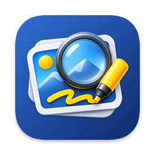
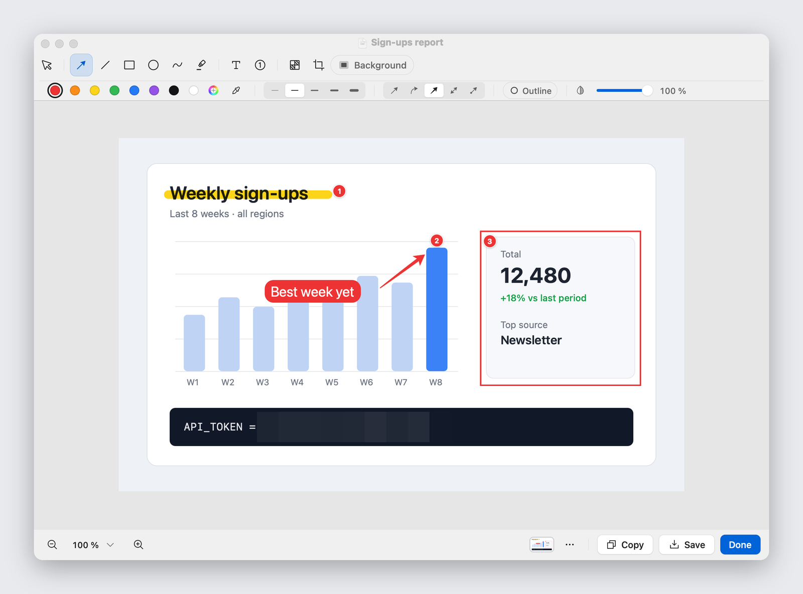
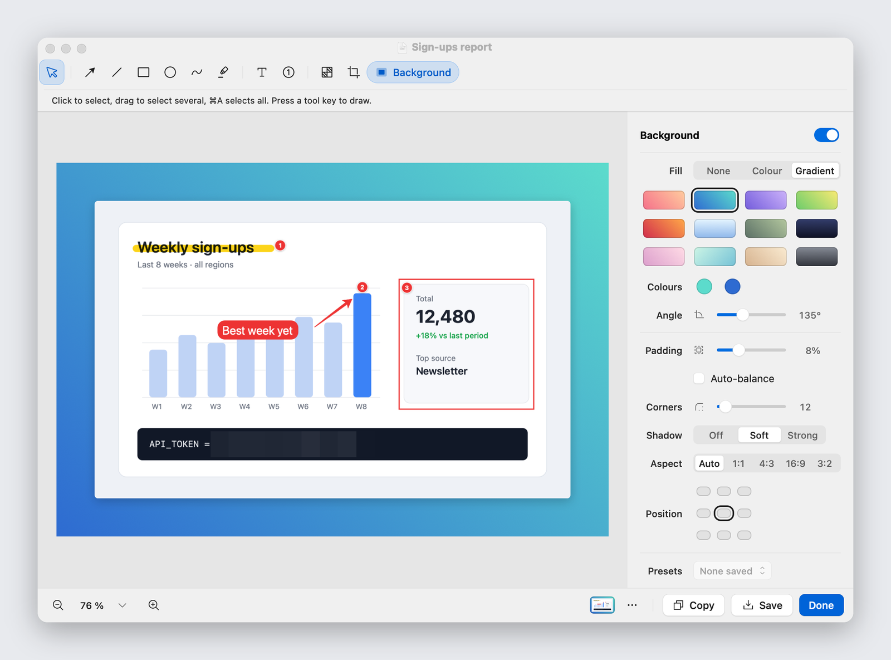
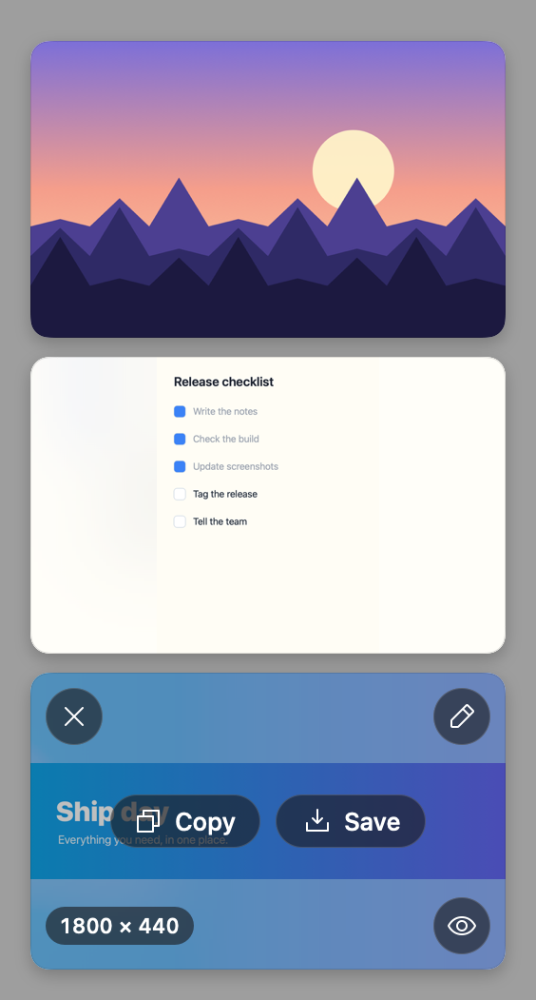
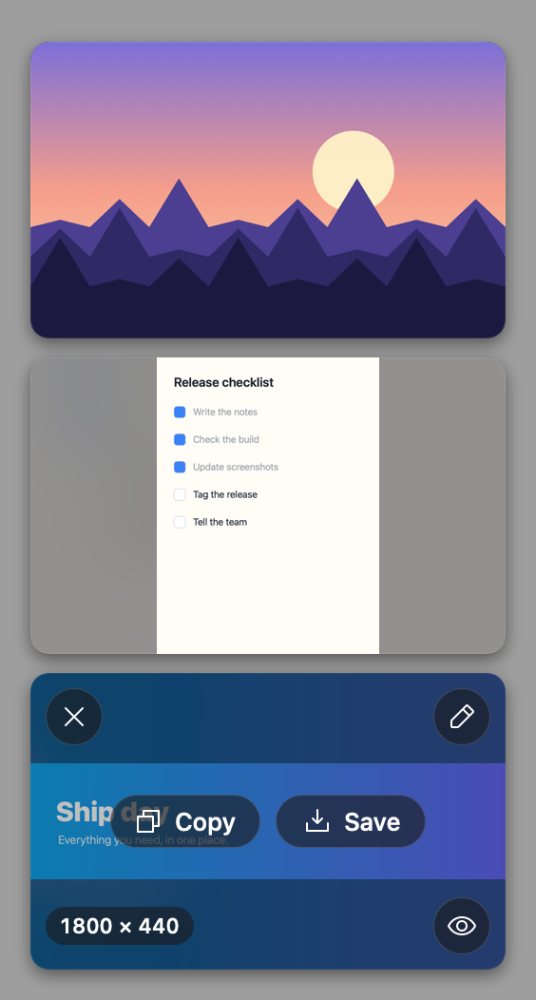
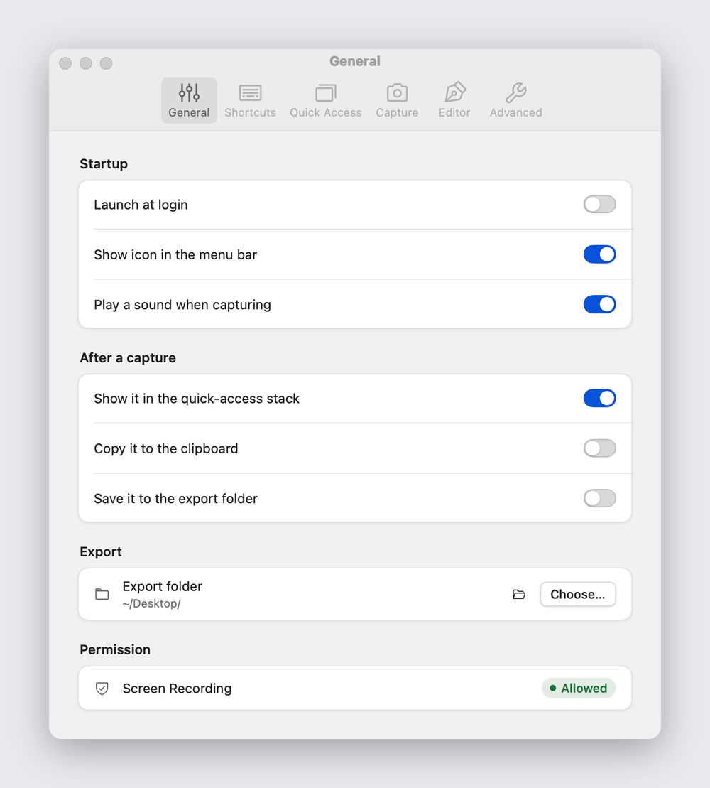

<p align="center">
  
</p>

# ShotZ

**A fast, native screenshot and annotation app for macOS.** Free and open source (MIT).

<p align="center">
  <a href="https://github.com/hoomanaskari/ShotZ/releases/latest">
    
  </a>
</p>

Press ⌘⇧4, drag over what you want, and the capture lands in a small stack of cards in the corner of the screen. Copy it, save it, drag it into another app, or open it in the editor to add arrows, boxes, text, numbered steps and blur, then put it on a background for sharing. ShotZ lives in the menu bar and keeps your captures on your Mac.

<picture>
  <source media="(prefers-color-scheme: dark)" srcset="docs/screenshots/editor-dark.png" />
  <source media="(prefers-color-scheme: light)" srcset="docs/screenshots/editor-light.png" />
  
</picture>

> **Status: first release.** ShotZ 0.1 takes still screenshots. It doesn't record video, capture scrolling pages, read text (OCR) or upload anywhere.

## What it does

- **Captures like macOS does.** ShotZ uses the system's own capture tool, so the crosshair, live coordinates and Space-to-capture-a-window behave exactly as you know them. Area (⌘⇧4), fullscreen (⌘⇧3) and the all-in-one capture toolbar (⌘⇧5); every shortcut can be changed. Window captures keep their shadow on a transparent background.
- **A quick-access stack.** Each capture appears as a card at the bottom-left of the screen (or right, if you prefer) without taking focus from what you're doing. Hover a card for **Copy**, **Save**, **Annotate**, **Quick Look** and **Close**, with keyboard shortcuts while the pointer is over it. Drag a card straight into Finder, Mail, a chat or a design tool. Double-click to open it in the editor.
- **An annotation editor.** Arrows (straight, curved, tapered, double-headed, line with a dot), rectangles, ellipses, lines, text with outline and pill styles, a highlighter that keeps text readable, blur, pixelate and solid redaction, numbered counters, a smoothed pen and non-destructive crop. Everything stays editable until you export: select, move, restyle, duplicate and reorder objects, with unlimited undo. Eight preset colours, a custom colour well and an eyedropper.
- **Backgrounds for sharing.** Wrap a capture in a solid colour or one of 12 gradients, with padding, rounded corners, a shadow and a fixed aspect ratio (1:1, 4:3, 16:9, 3:2). Save your own presets.
- **Drag out from anywhere.** Drag the finished image out of the editor (the thumbnail at the bottom right) or straight off a stack card.
- **Closing is saving.** Close the editor and your edits are kept with the capture; its card returns to the stack showing the annotated image. Reopen it later and every object is still editable.
- **Recent captures** stay in the menu-bar menu for re-opening; how long they're kept is up to you (a month by default).

<table>
  <tr>
    <td width="50%"></td>
    <td width="50%"></td>
  </tr>
  <tr>
    <td> </td>
    <td></td>
  </tr>
</table>

## Requirements

- macOS 15 Sequoia or later.
- Apple silicon or Intel: the release app is universal (`arm64` and `x86_64`), signed with a Developer ID and notarized by Apple.

## Install

1. Download the newest `.dmg` from [Releases](https://github.com/hoomanaskari/ShotZ/releases/latest).
2. Open it and drag **ShotZ** to Applications.
3. Open ShotZ. It lives in the menu bar, not in the Dock. The first time, a short welcome walks you through the steps below.

### Screen Recording permission

macOS asks you to allow ShotZ under **System Settings ▸ Privacy & Security ▸ Screen & System Audio Recording**. It's the only permission ShotZ needs. macOS may ask you to quit and reopen ShotZ after you allow it. Without it, a capture shows you how to grant the permission instead of an empty image. Settings ▸ General shows whether it's allowed.

### Free ⌘⇧3, ⌘⇧4 and ⌘⇧5

These shortcuts belong to macOS until you turn its own off: **System Settings ▸ Keyboard ▸ Keyboard Shortcuts… ▸ Screenshots**, then uncheck the screenshot shortcuts. If another screenshot app uses them, turn them off in that app too. ShotZ never changes your system settings itself; the welcome window checks these shortcuts and shows the steps if they're still taken. You can also give ShotZ different shortcuts in Settings ▸ Shortcuts.

More detail, including launch at login, is in [docs/INSTALL.md](docs/INSTALL.md). To remove ShotZ and everything it stored, see [docs/UNINSTALL.md](docs/UNINSTALL.md).

## Shortcuts

**Anywhere**

| Shortcut | Action |
|---|---|
| ⌘⇧3 | Capture the screen under the pointer |
| ⌘⇧4 | Capture an area (press Space to capture a window instead) |
| ⌘⇧5 | All-in-one capture toolbar |

**Pointer over a stack card**

| Shortcut | Action |
|---|---|
| ⌘C | Copy |
| ⌘S | Save to the export folder (Desktop by default) |
| ⌘E or Return | Open in the editor |
| Space | Quick Look |
| ⌘W or Esc | Close the card (the capture stays in your recent captures) |
| ⌘⌫ | Close and delete the capture |

**Editor**

| Key | Tool | | Shortcut | Action |
|---|---|---|---|---|
| V | Select | | ⇧⌘C | Copy the image |
| A | Arrow (again to change style) | | ⌘S | Save |
| R | Rectangle | | ⇧⌘S | Save As (PNG, JPEG or HEIC, 1× or 2×) |
| O | Ellipse | | ⌘W | Done: close and return to the stack |
| L | Line | | ⌘Z / ⇧⌘Z | Undo / redo |
| T | Text | | ⌘D | Duplicate |
| H | Highlighter | | ⌘0 / ⌘1 | Zoom to fit / actual size |
| B | Blur and redact | | ⌘+ / ⌘− | Zoom in / out |
| N | Numbered counter | | 1–8 | Preset colours |
| P | Pen | | Esc | Deselect, then back to Select |
| C | Crop | | | |
| G | Background panel | | | |

## Updates

ShotZ updates itself with [Sparkle](https://sparkle-project.org). It checks once a day and asks before installing anything. To check now, choose **Check for Updates…** in the menu-bar menu, or in **Settings ▸ Advanced ▸ Updates**, which also shows when ShotZ last checked and its version and build. To stop the daily check, turn off **Check for updates automatically** there.

The update feed is `appcast.xml` on this repository's `main` branch. Updates come from this repository's releases and are installed only if they carry ShotZ's EdDSA signature; every release is notarized by Apple.

## Privacy

- **No accounts, no analytics, no telemetry.**
- **Your captures stay on your Mac**, in ShotZ's own folder (listed in [docs/UNINSTALL.md](docs/UNINSTALL.md)), until you save, copy or drag them somewhere. Old captures are removed after the time you choose in Settings ▸ Advanced.
- **The only network access is the update check**, which reads ShotZ's update feed from GitHub. The request carries ShotZ's version and nothing about you, your Mac or your captures (Sparkle's optional system profile is off). Turn automatic checks off and ShotZ makes no network requests on its own.

## Building from source

You need Xcode 16 or later (Swift 6) on macOS 15 or later. ShotZ has one runtime dependency, [Sparkle](https://github.com/sparkle-project/Sparkle), which Swift Package Manager fetches on the first build.

```bash
git clone https://github.com/hoomanaskari/ShotZ.git
cd ShotZ
swift build
swift test
```

Run the development app, **ShotZ Dev**. It's a separate app with its own settings, captures, icon and Screen Recording permission, and its default shortcuts are ⌃⌥⌘3/4/5, so it can run next to an installed ShotZ:

```bash
scripts/run.sh
```

Build the release app into `build/ShotZ.app`. It is universal (`arm64` and `x86_64`); `SHOTZ_UNIVERSAL=0` builds for this Mac only:

```bash
scripts/bundle.sh release
```

Set the version with `scripts/bump-version.sh <version> [build]` (it edits `Resources/Info.plist`, the only place the version lives). A release build needs a code-signing identity (set `SHOTZ_SIGN_IDENTITY`, or it uses your first Apple Development certificate). With none, set `SHOTZ_ALLOW_ADHOC=1`; macOS then asks for the Screen Recording permission again after every rebuild.

Releases (signing, notarization, the DMG and the update feed) are built with `scripts/release.sh`; see [docs/RELEASE.md](docs/RELEASE.md). The app icon is rebuilt with `scripts/make-icons.sh` ([docs/ICON.md](docs/ICON.md)). The README screenshots are made from the app itself with `scripts/screenshots/make-screenshots.sh` (synthetic sample images, no screen reading).

## Project layout

ShotZ is Swift 6 and AppKit, split into small modules:

| Module | What it holds |
|---|---|
| `ShotzCore` | Shared types, settings, export and the protocols the modules talk through |
| `ShotzUI` | The design system: tokens and every control in the app |
| `CaptureKit` | Capture, through the system `screencapture` tool |
| `QuickAccess` | The quick-access stack |
| `AnnotationKit` | The annotation document, renderer, undo and export |
| `AnnotationEditor` | The editor window, canvas, tools and chrome |
| `AppShell` | Shortcuts, permissions, welcome window, Settings, menu-bar item, history |
| `Shotz` | The app itself, where the modules meet |

- [docs/SPEC.md](docs/SPEC.md): what ShotZ does, in detail.
- [docs/ARCHITECTURE.md](docs/ARCHITECTURE.md): modules, contracts, build and conventions.
- [docs/DESIGN.md](docs/DESIGN.md): the design system and its rules.
- [docs/RELEASE.md](docs/RELEASE.md): how a release is built.

## Contributing

Bug reports and fixes with tests are welcome. See [CONTRIBUTING.md](CONTRIBUTING.md). For security problems, see [SECURITY.md](SECURITY.md).

## Licence

[MIT](LICENSE). ShotZ uses [Phosphor Icons](https://github.com/phosphor-icons/core) (MIT) for its interface icons and [Sparkle](https://github.com/sparkle-project/Sparkle) (MIT) for updates. Their licences and copyright notices are in [THIRD-PARTY-NOTICES](THIRD-PARTY-NOTICES).
